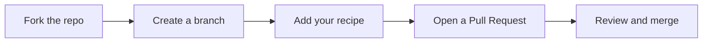

<div align="center">


<br>

**Practical tricks, settings, scripts, and shortcuts for getting more out of the web.**

<br>

[](https://github.com/rakibuilds/internet-tricks-cookbook/stargazers)
[](https://github.com/rakibuilds/internet-tricks-cookbook/network/members)
[](https://github.com/rakibuilds/internet-tricks-cookbook/issues)
[](LICENSE)

[](https://github.com/rakibuilds/internet-tricks-cookbook/pulls)
[](https://github.com/rakibuilds/internet-tricks-cookbook/commits/main)
[](https://github.com/rakibuilds/internet-tricks-cookbook)
[](https://github.com/rakibuilds/internet-tricks-cookbook/graphs/contributors)


[Categories](#categories) |
[Recipes](#recipes) |
[Quick Start](#quick-start) |
[Rules](#rules) |
[Contributing](#contributing) |
[License](#license)

</div>

---

## About

Internet Tricks Cookbook is an open-source library of short, self-contained recipes. Each recipe solves one specific problem: a hidden browser setting, a search shortcut, a privacy fix, or a small automation script.

It is built for two audiences:

- **Everyday users** who want cleaner browsing, better privacy, and faster workflows. No programming needed.
- **Developers** who want reusable scripts, DevTools snippets, and API recipes.

> [!NOTE]
> Every recipe starts with a short header stating what it does, what it needs, and how to use it.

---

## Categories

| | Category | What it covers |
|:-:|---|---|
|  | [**Browser and Search**](browser-and-search) | Search operators, hidden browser flags, reader settings, performance tweaks |
|  | [**Privacy and Accounts**](privacy-and-accounts) | Email aliasing, tracking-parameter removal, permission and cookie hygiene |
|  | [**Social and Content**](social-and-content) | Clean link sharing, feed resets, notification and autoplay controls |
|  | [**Everyday Savings**](everyday-savings) | Flight and hotel price comparison, regional pricing checks |
|  | [**Automation and Scraping**](automation) | Text extraction, RSS feed generation, page monitoring |
|  | [**DevTools**](devtools) | Console snippets, network throttling profiles, UI debugging |
|  | [**API and Webhooks**](api-and-webhooks) | Uptime checks, alerts, dynamic DNS updaters, integration recipes |

---

## Recipes

<details open>
<summary><b>All recipes</b> (click to collapse)</summary>

<br>

| Recipe | Category | Description |
|---|---|---|
| [`advanced-search-operators.txt`](browser-and-search/advanced-search-operators.txt) | Browser and Search | Cheat sheet of search commands for precise results |
| [`hidden-flags-config.txt`](browser-and-search/hidden-flags-config.txt) | Browser and Search | Browser settings to speed up page loads and block autoplay |
| [`disposable-email-routing.md`](privacy-and-accounts/disposable-email-routing.md) | Privacy and Accounts | Use aliases to protect your primary inbox |
| [`remove-tracking-parameters.md`](privacy-and-accounts/remove-tracking-parameters.md) | Privacy and Accounts | Strip tracking junk from links |
| [`clean-video-sharing.md`](social-and-content/clean-video-sharing.md) | Social and Content | Strip tracking tokens from shared video links |
| [`feed-algorithm-resets.md`](social-and-content/feed-algorithm-resets.md) | Social and Content | Clear stale recommendations on major platforms |
| [`price-comparison-tips.md`](everyday-savings/price-comparison-tips.md) | Everyday Savings | Find better flight and hotel prices |
| [`headless-scraper.js`](automation/headless-scraper.js) | Automation and Scraping | Extract clean text from messy web pages |
| [`rss-feed-generator.py`](automation/rss-feed-generator.py) | Automation and Scraping | Turn static pages into custom RSS feeds |
| [`devtools-console-tricks.md`](devtools/devtools-console-tricks.md) | DevTools | Console snippets for rapid UI debugging |
| [`network-throttling-profiles.json`](devtools/network-throttling-profiles.json) | DevTools | Simulate real-world mobile connections |
| [`status-check-webhook.sh`](api-and-webhooks/status-check-webhook.sh) | API and Webhooks | Monitor endpoint uptime and trigger alerts |
| [`dynamic-dns-updater.py`](api-and-webhooks/dynamic-dns-updater.py) | API and Webhooks | Keep a home server IP updated automatically |

</details>

---

## Quick Start

**For guides:** open any `.md` file in a [category folder](#categories) and follow the steps.

**For scripts:**

```bash
git clone https://github.com/rakibuilds/internet-tricks-cookbook.git
cd internet-tricks-cookbook
```

Open a category folder and read the header of the file you want to run for its dependencies and usage notes.


---

## Rules

> [!TIP]
> **Allowed**
> - Browser and app settings, UI tweaks, and hidden toggles
> - Privacy and tracking-reduction techniques
> - Search shortcuts and productivity workflows
> - Automation scripts, API recipes, and DevTools snippets

> [!CAUTION]
> **Not allowed**
> - Account hijacking, credential harvesting, or phishing tools
> - Malware, exploits, or anything designed to cause harm
> - Bypassing paywalls, licensing, or access controls on content you have no right to access
> - Anything that violates the law or harms others

Scripts that fetch web pages should respect `robots.txt`, rate limits, and site terms of service.

---

## Contributing

Contributions are welcome. Tricks go stale as platforms change, so fixes and updates matter as much as new recipes. Read [CONTRIBUTING.md](CONTRIBUTING.md) for the full guide, including the repository structure and recipe format.



1. [Fork the repository](https://github.com/rakibuilds/internet-tricks-cookbook/fork).
2. Create a branch: `git checkout -b trick/your-trick-name`
3. Add your file to the most relevant [category folder](#categories).
4. Copy [`RECIPE_TEMPLATE.md`](RECIPE_TEMPLATE.md) and follow its header (purpose, requirements, usage).
5. [Open a Pull Request](https://github.com/rakibuilds/internet-tricks-cookbook/compare) describing the problem your trick solves.

Found a broken or outdated recipe? [Open an issue](https://github.com/rakibuilds/internet-tricks-cookbook/issues/new).

---

## License

Released under the [MIT License](LICENSE). You are free to use, modify, and redistribute the contents of this repository.

<div align="center">

<br>

If this repo helped you, consider giving it a star.

[](https://github.com/rakibuilds/internet-tricks-cookbook)

</div>