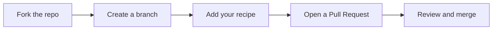

<div align="center">


<br>

**Practical tricks, settings, scripts, and shortcuts for getting more out of the web.**

<br>

[](https://github.com/rakibuilds/internet-tricks-cookbook/stargazers)
[](https://github.com/rakibuilds/internet-tricks-cookbook/network/members)
[](https://github.com/rakibuilds/internet-tricks-cookbook/issues)
[](LICENSE)

[](https://github.com/rakibuilds/internet-tricks-cookbook/pulls)
[](https://github.com/rakibuilds/internet-tricks-cookbook/commits/main)
[](https://github.com/rakibuilds/internet-tricks-cookbook)
[](https://github.com/rakibuilds/internet-tricks-cookbook/graphs/contributors)


[Categories](#categories) |
[Recipes](#recipes) |
[Quick Start](#quick-start) |
[Rules](#rules) |
[Contributing](#contributing) |
[License](#license)

</div>

---

## About

Internet Tricks Cookbook is an open-source library of short, self-contained recipes. Each recipe solves one specific problem: a hidden browser setting, a search shortcut, a privacy fix, or a small automation script.

It is built for two audiences:

- **Everyday users** who want cleaner browsing, better privacy, and faster workflows. No programming needed.
- **Developers** who want reusable scripts, DevTools snippets, and API recipes.

> [!NOTE]
> Every recipe starts with a short header stating what it does, what it needs, and how to use it.

---

## Categories

<!-- CATEGORIES:START -->
| | Section | What it covers | Recipes |
|:-:|---|---|:-:|
|  | [**Social Media**](social-media) | Platform-by-platform tips for YouTube, Instagram, Facebook, X, TikTok, WhatsApp, Reddit, and LinkedIn | 17 |
|  | [**Browsers and Search**](browsers) | Shortcuts, settings, and search tricks for Chrome, Firefox, and web search | 7 |
|  | [**Privacy and Security**](privacy-and-security) | Accounts, passwords, email aliases, tracking removal, and scam spotting | 7 |
|  | [**Developer**](developer) | DevTools, automation scripts, API and webhook recipes, Git and GitHub | 11 |
|  | [**Everyday**](everyday) | Windows shortcuts, maps, and savings tips | 3 |
|  | [**API and Webhooks**](api-and-webhooks) |  | 2 |
|  | [**Automation and Scraping**](automation) |  | 2 |
|  | [**Browser And Search**](browser-and-search) |  | 2 |
|  | [**DevTools**](devtools) |  | 2 |
|  | [**Everyday Savings**](everyday-savings) |  | 1 |
|  | [**Privacy And Accounts**](privacy-and-accounts) |  | 2 |
|  | [**Social And Content**](social-and-content) |  | 2 |
<!-- CATEGORIES:END -->

---

## Recipes

Open a section for its full index, or expand a section below.

<!-- RECIPES:START -->
<details>
<summary><b>Social Media</b> (17 recipes)</summary>

<br>

[Open the Social Media index](social-media/README.md)

**Facebook**

| Recipe | Description |
|---|---|
| [Facebook: Feed Controls](social-media/facebook/feed-controls.md) | Make Facebook show you people and posts you actually want. |
| [Facebook: Privacy Checkup](social-media/facebook/privacy-checkup.md) | Review who sees your posts and what data Facebook and apps can use. |

**General**

| Recipe | Description |
|---|---|
| [Clean Video Sharing](social-media/general/clean-video-sharing.md) | Share video links without tracking tokens or an unwanted start time. |
| [Download Your Data From Social Platforms](social-media/general/download-your-data.md) | Export a copy of your account data before deleting an account or switching services. |
| [Reset Recommendation Feeds](social-media/general/feed-algorithm-resets.md) | Clear stale or unwanted recommendations on major platforms. |

**Instagram**

| Recipe | Description |
|---|---|
| [Instagram: Control Your Feed](social-media/instagram/control-your-feed.md) | Choose what Instagram shows you and reduce unwanted content. |
| [Instagram: Privacy and Safety Settings](social-media/instagram/privacy-and-safety-settings.md) | Lock down who can see and contact you on Instagram. |

**LinkedIn**

| Recipe | Description |
|---|---|
| [LinkedIn: Search and Privacy](social-media/linkedin/search-and-privacy.md) | Search LinkedIn precisely and control who sees your activity. |

**Reddit**

| Recipe | Description |
|---|---|
| [Reddit Search and Feeds](social-media/reddit/search-and-feeds.md) | Find better results on Reddit and organize what you read. |

**TikTok**

| Recipe | Description |
|---|---|
| [TikTok: Content Controls](social-media/tiktok/content-controls.md) | Tune your For You feed and set limits on what and how long you watch. |

**WhatsApp**

| Recipe | Description |
|---|---|
| [WhatsApp Handy Features](social-media/whatsapp/handy-features.md) | Use lesser-known WhatsApp features for notes, search, and organization. |
| [WhatsApp Privacy Settings](social-media/whatsapp/privacy-settings.md) | Control who can see you and contact you on WhatsApp. |
| [WhatsApp Text Formatting](social-media/whatsapp/text-formatting.md) | Format messages with bold, italics, lists, and code. |

**X (Twitter)**

| Recipe | Description |
|---|---|
| [X (Twitter): Mute, Filter, and Organize](social-media/x-twitter/mute-and-filter.md) | Clean up your timeline and notifications. |
| [X (Twitter) Search Operators](social-media/x-twitter/search-operators.md) | Find exact posts quickly with advanced search commands. |

**YouTube**

| Recipe | Description |
|---|---|
| [YouTube Keyboard Shortcuts](social-media/youtube/keyboard-shortcuts.md) | Control YouTube videos quickly without touching the mouse. |
| [YouTube Playback Controls](social-media/youtube/playback-controls.md) | Use hidden player options for speed, looping, timestamps, and diagnostics. |

</details>

<details>
<summary><b>Browsers and Search</b> (7 recipes)</summary>

<br>

[Open the Browsers and Search index](browsers/README.md)

**Chrome**

| Recipe | Description |
|---|---|
| [Custom Search Shortcuts in Chrome and Edge](browsers/chrome/custom-search-shortcuts.md) | Search any site straight from the address bar with a short keyword. |
| [Chrome Keyboard Shortcuts](browsers/chrome/keyboard-shortcuts.md) | Navigate Chrome faster with the shortcuts that save the most time. |

**Firefox**

| Recipe | Description |
|---|---|
| [Firefox about: Pages](browsers/firefox/about-pages.md) | Use Firefox's built-in diagnostic and settings pages. |
| [Firefox: Containers and Reader View](browsers/firefox/containers-and-reader-view.md) | Separate accounts and sites from each other, and read pages without clutter. |

**General**

| Recipe | Description |
|---|---|
| [Hidden Flags Config](browsers/general/hidden-flags-config.txt) | Speed up browsing and stop autoplay with built-in settings. |

**Search**

| Recipe | Description |
|---|---|
| [Advanced Search Operators](browsers/search/advanced-search-operators.txt) | Get precise results from Google-style search engines. |
| [Search Engine Quick Answers](browsers/search/quick-answers.md) | Get instant answers by typing a simple phrase into search. |

</details>

<details>
<summary><b>Privacy and Security</b> (7 recipes)</summary>

<br>

[Open the Privacy and Security index](privacy-and-security/README.md)

**General**

| Recipe | Description |
|---|---|
| [Check for Data Breaches](privacy-and-security/check-data-breaches.md) | Find out whether your email or passwords appeared in a known leak. |
| [Email Aliasing](privacy-and-security/disposable-email-routing.md) | Sign up for services without exposing your main inbox, and trace who leaks or sells your address. |
| [Remove Tracking Parameters From Links](privacy-and-security/remove-tracking-parameters.md) | Strip tracking junk from URLs before sharing or bookmarking. |
| [Review App and Account Permissions](privacy-and-security/review-app-permissions.md) | Remove old apps and sites that can still access your accounts. |
| [Spot Phishing Links and Messages](privacy-and-security/spot-phishing-links.md) | Recognize scam emails and texts before you click. |
| [Strong Passwords and Passkeys](privacy-and-security/strong-passwords-and-passkeys.md) | Build passwords you will not need to remember, and move to passkeys where possible. |
| [Two-Factor Authentication](privacy-and-security/two-factor-authentication.md) | Protect accounts so a stolen password alone is not enough. |

</details>

<details>
<summary><b>Developer</b> (11 recipes)</summary>

<br>

[Open the Developer index](developer/README.md)

**API and Webhooks**

| Recipe | Description |
|---|---|
| [curl Cheatsheet](developer/api-and-webhooks/curl-cheatsheet.md) | Make HTTP requests from the terminal for testing APIs and checking sites. |
| [Dynamic Dns Updater](developer/api-and-webhooks/dynamic-dns-updater.py) | Keep a DNS A record pointed at your home server's public IP. |
| [Status Check Webhook](developer/api-and-webhooks/status-check-webhook.sh) | Check that a URL responds, and post an alert to a webhook if not. |

**Automation and Scraping**

| Recipe | Description |
|---|---|
| [Headless Scraper](developer/automation/headless-scraper.js) | Extract readable text from web pages, including JavaScript-rendered ones. |
| [Rss Feed Generator](developer/automation/rss-feed-generator.py) | Turn the links on a web page into an RSS feed. |

**DevTools**

| Recipe | Description |
|---|---|
| [DevTools Console Tricks](developer/devtools/devtools-console-tricks.md) | Console shortcuts for faster debugging and testing. |
| [Network Throttling Profiles](developer/devtools/network-throttling-profiles.json) | Simulate real-world mobile network speeds in automated browser tests. |
| [DevTools Shortcuts and Commands](developer/devtools/shortcuts-and-commands.md) | Use Chrome and Edge DevTools shortcuts and the command menu to work faster. |

**Git and GitHub**

| Recipe | Description |
|---|---|
| [Fork, Sync, and Contribute](developer/git-and-github/fork-and-sync-upstream.md) | Work on a fork, keep it updated, and send changes back to the original repository. |
| [Git Undo Cheatsheet](developer/git-and-github/git-undo-cheatsheet.md) | Fix common Git mistakes without panic. |
| [GitHub Shortcuts and URL Tricks](developer/git-and-github/github-shortcuts.md) | Navigate GitHub faster using keyboard shortcuts and URL changes. |

</details>

<details>
<summary><b>Everyday</b> (3 recipes)</summary>

<br>

[Open the Everyday index](everyday/README.md)

**General**

| Recipe | Description |
|---|---|
| [Google Maps: Offline Maps and Location Sharing](everyday/google-maps-offline.md) | Use maps without internet and share your location safely. |
| [Price Comparison Tips for Flights and Hotels](everyday/price-comparison-tips.md) | Find better prices with legitimate methods. |
| [Windows Shortcuts](everyday/windows-shortcuts.md) | Use Windows shortcuts that save time every day. |

</details>

<details>
<summary><b>API and Webhooks</b> (2 recipes)</summary>

<br>

[Open the API and Webhooks index](api-and-webhooks/README.md)

**General**

| Recipe | Description |
|---|---|
| [Dynamic Dns Updater](api-and-webhooks/dynamic-dns-updater.py) | Keep a DNS A record pointed at your home server's public IP. |
| [Status Check Webhook](api-and-webhooks/status-check-webhook.sh) | Check that a URL responds, and post an alert to a webhook if not. |

</details>

<details>
<summary><b>Automation and Scraping</b> (2 recipes)</summary>

<br>

[Open the Automation and Scraping index](automation/README.md)

**General**

| Recipe | Description |
|---|---|
| [Headless Scraper](automation/headless-scraper.js) | Extract clean readable text from a web page, including |
| [Rss Feed Generator](automation/rss-feed-generator.py) | Turn the links on a web page into an RSS feed. |

</details>

<details>
<summary><b>Browser And Search</b> (2 recipes)</summary>

<br>

[Open the Browser And Search index](browser-and-search/README.md)

**General**

| Recipe | Description |
|---|---|
| [Advanced Search Operators](browser-and-search/advanced-search-operators.txt) | Get precise results from Google-style search engines. |
| [Hidden Flags Config](browser-and-search/hidden-flags-config.txt) | Speed up browsing and stop autoplay with built-in settings. |

</details>

<details>
<summary><b>DevTools</b> (2 recipes)</summary>

<br>

[Open the DevTools index](devtools/README.md)

**General**

| Recipe | Description |
|---|---|
| [DevTools Console Tricks](devtools/devtools-console-tricks.md) | Console shortcuts for faster debugging and testing. |
| [Network Throttling Profiles](devtools/network-throttling-profiles.json) |  |

</details>

<details>
<summary><b>Everyday Savings</b> (1 recipes)</summary>

<br>

[Open the Everyday Savings index](everyday-savings/README.md)

**General**

| Recipe | Description |
|---|---|
| [Price Comparison Tips for Flights and Hotels](everyday-savings/price-comparison-tips.md) | Find better prices with legitimate methods. |

</details>

<details>
<summary><b>Privacy And Accounts</b> (2 recipes)</summary>

<br>

[Open the Privacy And Accounts index](privacy-and-accounts/README.md)

**General**

| Recipe | Description |
|---|---|
| [Email Aliasing](privacy-and-accounts/disposable-email-routing.md) | Sign up for services without exposing your main inbox, and trace who leaks or sells your address. |
| [Remove Tracking Parameters From Links](privacy-and-accounts/remove-tracking-parameters.md) | Strip tracking junk from URLs before sharing or bookmarking. |

</details>

<details>
<summary><b>Social And Content</b> (2 recipes)</summary>

<br>

[Open the Social And Content index](social-and-content/README.md)

**General**

| Recipe | Description |
|---|---|
| [Clean Video Sharing](social-and-content/clean-video-sharing.md) | Share video links without tracking tokens or an unwanted start time. |
| [Reset Recommendation Feeds](social-and-content/feed-algorithm-resets.md) | Clear stale or unwanted recommendations on major platforms. |

</details>
<!-- RECIPES:END -->

---

## Quick Start

**For guides:** open any `.md` file in a [category folder](#categories) and follow the steps.

**For scripts:**

```bash
git clone https://github.com/rakibuilds/internet-tricks-cookbook.git
cd internet-tricks-cookbook
```

Open a category folder and read the header of the file you want to run for its dependencies and usage notes.


---

## Rules

> [!TIP]
> **Allowed**
> - Browser and app settings, UI tweaks, and hidden toggles
> - Privacy and tracking-reduction techniques
> - Search shortcuts and productivity workflows
> - Automation scripts, API recipes, and DevTools snippets

> [!CAUTION]
> **Not allowed**
> - Account hijacking, credential harvesting, or phishing tools
> - Malware, exploits, or anything designed to cause harm
> - Bypassing paywalls, licensing, or access controls on content you have no right to access
> - Anything that violates the law or harms others

Scripts that fetch web pages should respect `robots.txt`, rate limits, and site terms of service.

---

## Contributing

Contributions are welcome. Tricks go stale as platforms change, so fixes and updates matter as much as new recipes. Read [CONTRIBUTING.md](CONTRIBUTING.md) for the full guide, including the repository structure, where each trick goes, and the recipe format.



1. [Fork the repository](https://github.com/rakibuilds/internet-tricks-cookbook/fork).
2. Create a branch: `git checkout -b trick/your-trick-name`
3. Add your file to the most relevant [category folder](#categories).
4. Copy [`RECIPE_TEMPLATE.md`](RECIPE_TEMPLATE.md) and follow its header (purpose, requirements, usage).
5. Run `python scripts/build_index.py` to refresh the indexes.
6. [Open a Pull Request](https://github.com/rakibuilds/internet-tricks-cookbook/compare) describing the problem your trick solves.

Found a broken or outdated recipe? [Open an issue](https://github.com/rakibuilds/internet-tricks-cookbook/issues/new).

---

## License

Released under the [MIT License](LICENSE). You are free to use, modify, and redistribute the contents of this repository.

<div align="center">

<br>

If this repo helped you, consider giving it a star.

[](https://github.com/rakibuilds/internet-tricks-cookbook)

</div>
